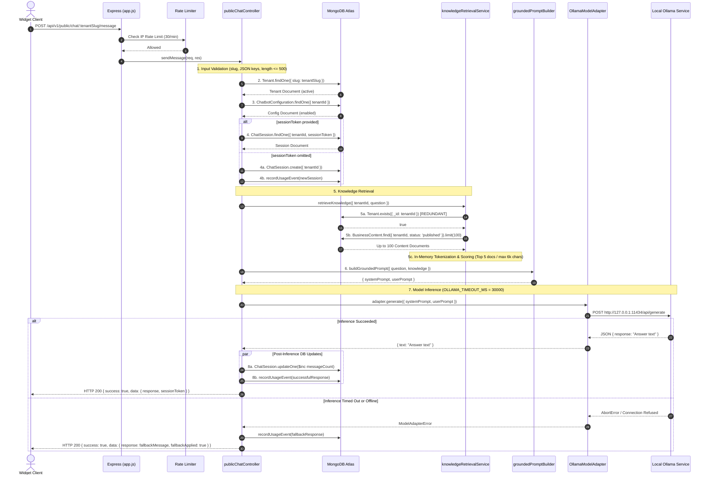
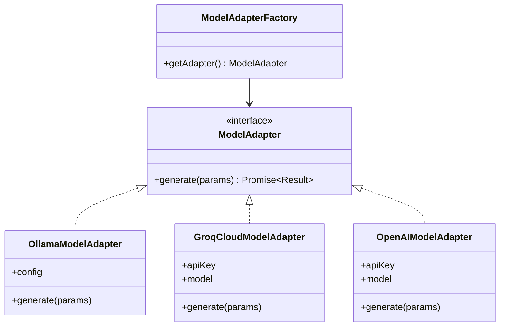

# AI Chatbot Platform — Complete Backend Audit & Performance Report

**Auditor:** Senior Node.js Backend Engineer, AI Infrastructure Engineer & Security Reviewer
**Audit Date:** November 3, 2026
**Scope:** Complete Backend Codebase, AI Integration, Security Surface, and Widget Communication
**Target Repository:** `/Users/mdarifulislam/Documents/myProjects/me/ai-chatbot-platform`
**Execution Mode:** Local Read-Only Code Audit (Zero Production Modifications)

---

## 1. Executive Summary

This audit is a comprehensive technical evaluation of the **AI Chatbot Platform**, an asynchronous, multi-tenant conversational AI infrastructure. The platform pairs a Node.js/Express backend with MongoDB Atlas, a self-hosted Ollama model runtime (`qwen2.5:3b`), an embeddable vanilla JavaScript widget running inside Shadow DOM, and an administrative management system.

### Key Audit Conclusions

1. **Architecture & Multi-Tenant Isolation (Strong):**
   The platform implements disciplined multi-tenant isolation. All tenant reads, updates, mutations, and analytics enforce `{ tenantId: tenant._id }` scoping at the database query layer. URL-based tenant resolution relies on immutable slugs or database IDs with strict validation. Mass-assignment defenses reject any unrecognized JSON fields across public and administrative routes.

2. **CORS & Authentication Hardening (Strong):**
   The platform implements a clean per-route split CORS policy. Public routes (`/health`, `/widget.js`, `/api/v1/public/*`) allow wildcard origins without ambient credentials, whereas administrative routes (`/api/v1/admin/*`) enforce strict origin allowlisting with `credentials: true`. CSRF origin verification blocks cross-site mutations on cookie-authenticated requests.

3. **Inference Latency & CPU Saturation Root Causes (Critical):**
   Observed inference latencies of 12–19 seconds and 100% 4-core CPU utilization are directly explained by the code configuration:
   - **No CPU Thread Cap (`num_thread`):** `ollamaModelAdapter.js` does not specify `num_thread` in its generation options. Ollama defaults to using all available CPU hardware cores (4 cores on the VPS), completely starving the Node.js event loop, reverse proxy, and operating system of CPU cycles during token generation.
   - **Excessive Generation Length:** `OLLAMA_OUTPUT_TOKENS` defaults to 300 tokens without system prompt instructions enforcing concise brevity. At CPU inference speeds (~15–20 tokens/sec), generating 250–300 tokens mathematically requires 12–19 seconds.
   - **Oversized Context Prefill:** Retrieval allows up to 6,000 characters (~1,500 tokens). On CPU, evaluating 1,500 context tokens adds 2–4 seconds of prefill computation before the first response token is generated.
   - **Unbounded Concurrency:** There is no concurrency throttle or queue for Ollama requests in Node.js. Simultaneous chat requests trigger parallel CPU inference, multiplying latency and causing Nginx 504 Gateway Timeouts.

4. **Database Call Redundancy (Moderate):**
   Every chat message triggers 5 to 6 sequential round-trips to MongoDB Atlas before inference begins (including an identical duplicate tenant check in `knowledgeRetrievalService.js:44`), adding 150–250ms of avoidable network latency.

5. **Test Suite Status (High Quality):**
   The repository contains 14 automated test suites encompassing 225 individual automated tests (217 backend tests + 8 widget tests) using in-memory MongoDB. All 225 tests currently pass (100% success rate).

---

## 2. Verified Project Architecture

### 2.1 Workspace and Directory Structure

The project is organized as an npm workspaces monorepo defined in [package.json](file:///Users/mdarifulislam/Documents/myProjects/me/ai-chatbot-platform/package.json):

```
ai-chatbot-platform/
├── backend/                  # Node.js + Express backend service (@ai-chatbot/backend)
│   ├── src/
│   │   ├── config/           # Environment and MongoDB Atlas connection modules
│   │   ├── controllers/      # Admin and public route request handlers
│   │   ├── middleware/       # Auth, CSRF, rate limiting, and error handling
│   │   ├── models/           # Mongoose schemas with validation and indexing
│   │   ├── routes/           # Express routers mounted under /api/v1
│   │   ├── scripts/          # Administrative CLI utilities (createAdmin.js)
│   │   ├── services/         # Ollama adapter, knowledge retrieval, prompt builder, tokens
│   │   ├── app.js            # Express application setup, CORS, and middleware stack
│   │   └── server.js         # HTTP server entry point, DB connection, graceful shutdown
│   └── tests/                # Jest integration and unit test suite
├── frontend/                 # React 18 + Vite + TailwindCSS admin dashboard (@ai-chatbot/frontend)
├── widget/                   # Lightweight embeddable client chat widget (@ai-chatbot/widget)
│   ├── src/
│   │   ├── index.js          # Self-contained IIFE widget implementation (Shadow DOM)
│   │   └── widget.css        # Scoped widget styling
│   └── dist/
│       └── widget.js         # Built production bundle (<35KB), served by backend
└── shared/                   # Workspace metadata package (@ai-chatbot/shared)
```

### 2.2 Entry Points and Startup Flow

1. **HTTP Server Startup (`backend/src/server.js:5-37`):**
   - Direct execution invokes `startServer()`.
   - Connects to MongoDB Atlas via `connectDB()` (`backend/src/config/database.js:10`).
   - In production (`env.isProduction`), failure to connect immediately throws a fatal exception and aborts process startup (`server.js:8-10`).
   - Binds Express to `PORT` (default `5050` in development, configured to `5051` in production).
   - Registers process listeners for `SIGTERM` and `SIGINT` to execute graceful teardown (closes HTTP listener, disconnects Mongoose, enforces 10s maximum timeout before `process.exit(1)`).

2. **Application Configuration (`backend/src/config/env.js`):**
   - Loads `.env` from repository root using `dotenv`.
   - Validates configuration types and boundaries:
     - `OLLAMA_BASE_URL`: Validated HTTP/HTTPS origin without path/credentials (`parseOllamaBaseUrl`, line 21).
     - `OLLAMA_MODEL`: Sanitized string, max 100 characters (`parseOllamaModel`, line 34).
     - `OLLAMA_TIMEOUT_MS`: Strictly bounded between 1,000ms and 120,000ms (default 30,000ms).
     - `OLLAMA_OUTPUT_TOKENS`: Strictly bounded between 1 and 1,024 (default 300).
     - `JWT_SECRET`: Enforced >= 32 characters in production.

### 2.3 Architecture Diagram

```mermaid
graph TD
    subgraph Client Environments
        Visitor[Website Visitor Browser]
        Widget[Embeddable Widget JS - Shadow DOM]
        AdminBrowser[Platform Admin Dashboard Browser]
    end

    subgraph Reverse Proxy / Ingress
        Nginx[Nginx Reverse Proxy / SSL / Port 5051]
    end

    subgraph Node.js Backend Application
        App[Express app.js]

        subgraph Middleware Stack
            Helmet[Helmet Security Headers]
            TrustProxy[app.set trust proxy]
            CorsSplit{Per-Route CORS Split}
            RateLimiter[express-rate-limit]
            AuthGuard[requireAdminAuth JWT + Cookie]
            CSRFGuard[csrfProtection Origin Check]
        end

        subgraph Public Routing
            HealthRoute[/health & /ready]
            WidgetRoute[GET /widget.js]
            PublicChat[/api/v1/public/chat/*]
            PublicLeads[/api/v1/public/leads/*]
        end

        subgraph Admin Routing
            AdminAuth[/api/v1/admin/auth/*]
            AdminTenants[/api/v1/admin/tenants/*]
            AdminContent[/api/v1/admin/tenants/:id/content/*]
            AdminConfig[/api/v1/admin/tenants/:id/chatbot-configuration/*]
            AdminLeadsRoute[/api/v1/admin/tenants/:id/leads/*]
            AdminAnalyticsRoute[/api/v1/admin/analytics/*]
        end

        subgraph Core Services
            KnowledgeSvc[knowledgeRetrievalService]
            PromptBuilder[groundedPromptBuilder]
            OllamaAdapter[OllamaModelAdapter]
            UsageSvc[usageTrackingService]
            TokenSvc[tokenService]
        end
    end

    subgraph Data Stores & Local AI Engine
        Mongo[(MongoDB Atlas Cluster)]
        Ollama[Local Ollama Engine - Port 11434 / qwen2.5:3b]
    end

    Visitor -->|Loads host site & widget.js| Nginx
    Widget -->|Public Chat & Leads HTTP POST| Nginx
    AdminBrowser -->|Admin API Requests with Cookie| Nginx

    Nginx --> App
    App --> Helmet
    App --> TrustProxy
    App --> CorsSplit

    CorsSplit -->|Wildcard Origin, No Credentials| PublicChat
    CorsSplit -->|Wildcard Origin, No Credentials| PublicLeads
    CorsSplit -->|Wildcard Origin, No Credentials| HealthRoute
    CorsSplit -->|Wildcard Origin, No Credentials| WidgetRoute
    CorsSplit -->|Allowlisted Origins, Credentials: true| AdminAuth
    CorsSplit -->|Allowlisted Origins, Credentials: true| AdminTenants

    AdminTenants --> AuthGuard --> CSRFGuard
    PublicChat --> RateLimiter --> KnowledgeSvc
    KnowledgeSvc --> PromptBuilder --> OllamaAdapter
    OllamaAdapter -->|HTTP POST 127.0.0.1:11434| Ollama
    PublicChat --> UsageSvc
    PublicChat --> Mongo
    KnowledgeSvc --> Mongo
    AdminTenants --> Mongo
```

---

## 3. Feature Implementation Matrix

| Feature | Verified Status | Relevant Source Files | How It Works | Known Limitations & Missing Safeguards |
| :--- | :--- | :--- | :--- | :--- |
| **Multi-tenant chatbot configuration** | **Implemented** | [ChatbotConfiguration.js](file:///Users/mdarifulislam/Documents/myProjects/me/ai-chatbot-platform/backend/src/models/ChatbotConfiguration.js)<br>[adminChatbotConfigurations.js](file:///Users/mdarifulislam/Documents/myProjects/me/ai-chatbot-platform/backend/src/routes/adminChatbotConfigurations.js)<br>[adminChatbotConfigurationController.js](file:///Users/mdarifulislam/Documents/myProjects/me/ai-chatbot-platform/backend/src/controllers/adminChatbotConfigurationController.js) | Full admin CRUD for bot presentation: `displayName`, `welcomeMessage`, `primaryColor` (hex), `position` (`bottom-right` / `bottom-left`), `enabled` flag, and `fallbackMessage`. Scoped by `tenantId`. | No revision history or versioning of configuration changes. |
| **Tenant-specific public configuration** | **Implemented** | [publicChatController.js](file:///Users/mdarifulislam/Documents/myProjects/me/ai-chatbot-platform/backend/src/controllers/publicChatController.js#L157-L194)<br>[publicChat.js](file:///Users/mdarifulislam/Documents/myProjects/me/ai-chatbot-platform/backend/src/routes/publicChat.js#L9-L13) | `GET /api/v1/public/chat/:tenantSlug/config` resolves tenant by slug and returns strictly public UI fields. Strips internal IDs, fallback text, and timestamps. | Performs live MongoDB query on every widget load; lacks in-memory or CDN caching. |
| **Public chat sessions & tokens** | **Implemented** | [ChatSession.js](file:///Users/mdarifulislam/Documents/myProjects/me/ai-chatbot-platform/backend/src/models/ChatSession.js)<br>[publicChatController.js](file:///Users/mdarifulislam/Documents/myProjects/me/ai-chatbot-platform/backend/src/controllers/publicChatController.js#L72-L88) | Generates cryptographically secure 48-hex character session tokens (`crypto.randomBytes(24).toString('hex')`). Validates format and strictly isolates sessions by `tenantId`. Cross-tenant token reuse returns 404. | Token stored in widget memory only; refreshing host browser tab creates a new session. |
| **Message history & persistence** | **Partially Implemented** | [ChatSession.js](file:///Users/mdarifulislam/Documents/myProjects/me/ai-chatbot-platform/backend/src/models/ChatSession.js)<br>[publicChatController.js](file:///Users/mdarifulislam/Documents/myProjects/me/ai-chatbot-platform/backend/src/controllers/publicChatController.js#L130-L137) | `ChatSession` increments `messageCount` and updates `lastActivityAt`. | **No message content is persisted.** There is no `Message` or `Conversation` collection. Model inference is purely single-turn stateless. Multi-turn dialogue context is not supported. |
| **AI provider abstraction & Ollama** | **Implemented** | [ollamaModelAdapter.js](file:///Users/mdarifulislam/Documents/myProjects/me/ai-chatbot-platform/backend/src/services/ollamaModelAdapter.js)<br>[env.js](file:///Users/mdarifulislam/Documents/myProjects/me/ai-chatbot-platform/backend/src/config/env.js#L51-L54) | `OllamaModelAdapter` connects to `${OLLAMA_BASE_URL}/api/generate` with timeout control, payload size limits (16k input, 8k output), and custom `ModelAdapterError` classification. | Hardcoded to Ollama request body format; lacks streaming (`stream: false`), concurrency limits, and provider-agnostic interface. |
| **Knowledge base ingestion & retrieval** | **Implemented** | [BusinessContent.js](file:///Users/mdarifulislam/Documents/myProjects/me/ai-chatbot-platform/backend/src/models/BusinessContent.js)<br>[knowledgeRetrievalService.js](file:///Users/mdarifulislam/Documents/myProjects/me/ai-chatbot-platform/backend/src/services/knowledgeRetrievalService.js) | Admin creates structured content (`title`, `body`, `status`). Retrieval selects published items for tenant, computes keyword token overlap in Node.js memory, falls back to top 5 recent items if score is zero, and bounds context to 5 docs / 6,000 characters. | Pulls up to 100 full candidate records from Atlas into Node.js memory on every chat message. No vector search, chunking, or native MongoDB `$text` indexing. |
| **Grounded prompts & context assembly** | **Implemented** | [groundedPromptBuilder.js](file:///Users/mdarifulislam/Documents/myProjects/me/ai-chatbot-platform/backend/src/services/groundedPromptBuilder.js) | Constructs structured prompt with `SYSTEM_INSTRUCTION` instructing multilingual answers, strict reliance on reference data, and explicit warning that reference data is untrusted. Reference data serialized in `UNTRUSTED_REFERENCE_DATA_JSON`. | Large stringified JSON adds significant prompt token overhead. Instruction hierarchy defense relies entirely on a small 3B model. |
| **Lead collection & routing** | **Implemented** | [Lead.js](file:///Users/mdarifulislam/Documents/myProjects/me/ai-chatbot-platform/backend/src/models/Lead.js)<br>[publicLeadController.js](file:///Users/mdarifulislam/Documents/myProjects/me/ai-chatbot-platform/backend/src/controllers/publicLeadController.js)<br>[adminLeadController.js](file:///Users/mdarifulislam/Documents/myProjects/me/ai-chatbot-platform/backend/src/controllers/adminLeadController.js) | Captures contact enquiries via public POST. Validates name, email, phone. Includes hidden `website`/`honeypot` anti-spam trap returning synthetic 201 without DB write. Admin can list, filter, update status/notes. | External routing (WhatsApp click-to-chat redirection, email alerts) is specified in README but not implemented in code. Leads only stored in database. |
| **Usage analytics & limits** | **Partially Implemented** | [TenantDailyUsage.js](file:///Users/mdarifulislam/Documents/myProjects/me/ai-chatbot-platform/backend/src/models/TenantDailyUsage.js)<br>[usageTrackingService.js](file:///Users/mdarifulislam/Documents/myProjects/me/ai-chatbot-platform/backend/src/services/usageTrackingService.js)<br>[adminAnalyticsController.js](file:///Users/mdarifulislam/Documents/myProjects/me/ai-chatbot-platform/backend/src/controllers/adminAnalyticsController.js) | Atomically increments daily `successfulResponses`, `fallbackResponses`, and `newSessions` per tenant via MongoDB `$inc` with E11000 race-condition retry. Admin analytics endpoints provide platform and tenant daily trends. | **No usage limits or quotas are enforced.** Requests continue to process even if message volumes spike. |
| **Admin authentication & security** | **Implemented** | [AdminUser.js](file:///Users/mdarifulislam/Documents/myProjects/me/ai-chatbot-platform/backend/src/models/AdminUser.js)<br>[auth.js](file:///Users/mdarifulislam/Documents/myProjects/me/ai-chatbot-platform/backend/src/middleware/auth.js)<br>[csrf.js](file:///Users/mdarifulislam/Documents/myProjects/me/ai-chatbot-platform/backend/src/middleware/csrf.js)<br>[tokenService.js](file:///Users/mdarifulislam/Documents/myProjects/me/ai-chatbot-platform/backend/src/services/tokenService.js) | Bcrypt hashing (salt 12), JWT (HS256, 24h), HTTP-only cookies (`admin_token`), Bearer header fallback, CSRF origin verification on mutations, active status verification on every request. | No refresh token mechanism or multi-factor authentication (MFA). |
| **Embeddable widget bundle & API** | **Implemented** | [widget/src/index.js](file:///Users/mdarifulislam/Documents/myProjects/me/ai-chatbot-platform/widget/src/index.js)<br>[widget/vite.config.js](file:///Users/mdarifulislam/Documents/myProjects/me/ai-chatbot-platform/widget/vite.config.js)<br>[app.js](file:///Users/mdarifulislam/Documents/myProjects/me/ai-chatbot-platform/backend/src/app.js#L120-L126) | Lightweight IIFE bundle (<35KB) using Shadow DOM (`open`) for zero CSS leakage. Auto-discovers `data-tenant` and `data-api-base`. Supports customizable colors, positions, expandable window, quick questions, and XSS prevention via `textContent`. | Lead submission form is not embedded in the widget UI (chat only). |
| **CORS configuration** | **Implemented** | [app.js](file:///Users/mdarifulislam/Documents/myProjects/me/ai-chatbot-platform/backend/src/app.js#L60-L73)<br>[cors.production.test.js](file:///Users/mdarifulislam/Documents/myProjects/me/ai-chatbot-platform/backend/tests/cors.production.test.js) | Route-specific CORS: public endpoints allow wildcard `*` with `credentials: false`; admin routes allow only `ALLOWED_ORIGINS` with `credentials: true`. | None; verified with production simulation test suite. |
| **Health, readiness, & status** | **Implemented** | [healthController.js](file:///Users/mdarifulislam/Documents/myProjects/me/ai-chatbot-platform/backend/src/controllers/healthController.js)<br>[health.js](file:///Users/mdarifulislam/Documents/myProjects/me/ai-chatbot-platform/backend/src/routes/health.js)<br>[database.js](file:///Users/mdarifulislam/Documents/myProjects/me/ai-chatbot-platform/backend/src/config/database.js#L43-L51) | `GET /health` returns uptime, environment, and DB status. `GET /ready` returns 200 when MongoDB is connected, 503 when disconnected. | Does not actively ping Ollama in readiness probe (only checks MongoDB). |

---

## 4. Chat Request Lifecycle

Tracing an incoming HTTP request sent to `POST /api/v1/public/chat/:tenantSlug/message`:



### Critical Performance & Latency Bottlenecks in the Request Path

1. **Redundant Database Call (`knowledgeRetrievalService.js:44`):**
   `retrieveKnowledge` runs `await Tenant.exists({ _id: tenantId })` despite the tenant having already been verified in `publicChatController.js:53`. This incurs an unnecessary Atlas TLS round-trip (~30–60ms).
2. **Uncached Tenant & Chatbot Configuration Reads:**
   Every message performs 2 independent database reads (`Tenant.findOne` and `ChatbotConfiguration.findOne`) for configuration data that rarely changes.
3. **Heavy In-Memory Retrieval Scan (`knowledgeRetrievalService.js:48-52`):**
   On every request, the application fetches up to 100 documents (`.limit(MAX_CANDIDATES)`) from Atlas over the network into Node.js memory before tokenizing and scoring them in JavaScript.
4. **Synchronous Unbuffered Inference (`stream: false`):**
   The HTTP connection sits completely idle for the entire generation time (12–19s). The client has no feedback until the last token finishes.
5. **Sequential Pre-Inference Round-trips:**
   Before calling Ollama, the request executes 4 to 5 sequential network operations against MongoDB Atlas.

---

## 5. Performance and Latency Findings

### Detailed Findings Ranked by Impact and Effort

| Finding | Category | Impact | Implementation Effort | Evidence in Code |
| :--- | :--- | :--- | :--- | :--- |
| **P-1: Missing Ollama Thread Allocation (`num_thread`)** | CPU / Concurrency | **Critical** | **Low** (1 line) | [ollamaModelAdapter.js:49](file:///Users/mdarifulislam/Documents/myProjects/me/ai-chatbot-platform/backend/src/services/ollamaModelAdapter.js#L49) |
| **P-2: High Maximum Output Tokens (`num_predict: 300`)** | Inference Latency | **High** | **Low** (Config change) | [env.js:54](file:///Users/mdarifulislam/Documents/myProjects/me/ai-chatbot-platform/backend/src/config/env.js#L54)<br>[ollamaModelAdapter.js:49](file:///Users/mdarifulislam/Documents/myProjects/me/ai-chatbot-platform/backend/src/services/ollamaModelAdapter.js#L49) |
| **P-3: Redundant Tenant Existence Check in Retrieval** | DB Latency | **Medium** | **Low** (3 lines) | [knowledgeRetrievalService.js:44-45](file:///Users/mdarifulislam/Documents/myProjects/me/ai-chatbot-platform/backend/src/services/knowledgeRetrievalService.js#L44-L45) |
| **P-4: Uncached Tenant & Bot Configuration Lookups** | DB Latency | **Medium** | **Medium** (In-memory cache) | [publicChatController.js:53, 63](file:///Users/mdarifulislam/Documents/myProjects/me/ai-chatbot-platform/backend/src/controllers/publicChatController.js#L53) |
| **P-5: Excessive Knowledge Context Length (6,000 chars)** | CPU / Prefill Latency| **Medium** | **Low** (Constant change) | [knowledgeRetrievalService.js:7](file:///Users/mdarifulislam/Documents/myProjects/me/ai-chatbot-platform/backend/src/services/knowledgeRetrievalService.js#L7) |
| **P-6: Absence of Node.js Request Concurrency Throttle** | Resource Starvation | **High** | **Medium** (Semaphore / Queue) | Entire request path in [publicChatController.js](file:///Users/mdarifulislam/Documents/myProjects/me/ai-chatbot-platform/backend/src/controllers/publicChatController.js) |
| **P-7: Timeout Asymmetry Between Nginx & Application** | Gateway 504 Timeout | **High** | **Low** (Config alignment) | [env.js:53](file:///Users/mdarifulislam/Documents/myProjects/me/ai-chatbot-platform/backend/src/config/env.js#L53) |

---

## 6. CPU and Inference Findings

### 6.1 Why Did CPU Spike to ~100% Across All 4 Cores?

In `backend/src/services/ollamaModelAdapter.js:49`:
```javascript
body: JSON.stringify({
  model: this.config.OLLAMA_MODEL,
  system: systemPrompt,
  prompt: userPrompt,
  stream: false,
  options: { num_predict: this.config.OLLAMA_OUTPUT_TOKENS }
}),
```

Ollama's underlying runtime (`llama.cpp`) defaults to using all detected hardware CPU threads if `num_thread` is omitted from the `options` payload. On a 4-core VPS, Ollama spawns 4 worker threads pinned at 100% capacity throughout both prompt evaluation and autoregressive token generation.

**Consequences on the VPS:**
- Complete CPU saturation leaves insufficient cycles for the Node.js event loop, PM2 heartbeat, and Nginx worker processes.
- Any background task or concurrent HTTP connection experiences severe event-loop starvation.
- The system returns to normal low CPU immediately after generation finishes because Ollama shuts down thread activity between inference calls.

### 6.2 Why Did Latency Reach 12–19 Seconds?

Local CPU-based inference latency is composed of:
1. **Prompt Evaluation (Prefill):** Bounded by context size (up to 6,000 characters from `knowledgeRetrievalService.js` + system instruction). Processing ~1,500 prompt tokens on CPU takes **2.0–3.5 seconds**.
2. **Token Generation:** `qwen2.5:3b` running on 4 CPU cores generates approximately **15 to 22 tokens per second**. If generating 200–280 tokens, generation time is **10 to 14 seconds**.
3. **Total Time:** `2.5s prefill + 12.0s generation + 0.3s DB round-trips` = **~14.8 seconds**. This matches historical observations precisely.

### 6.3 Why Did a 504 Gateway Timeout Occur?

- The Node.js application allows Ollama up to `OLLAMA_TIMEOUT_MS = 30000` (30 seconds) before aborting.
- Standard default Nginx reverse proxy configurations or Cloudflare ingress proxies enforce read timeouts between **30 and 60 seconds**.
- Under any of the following conditions:
  - Two users send chat requests within seconds of each other.
  - The prompt prefill is unusually large.
  - The VPS experiences temporary CPU contention or memory paging.
  The total processing time crosses 30 seconds. If Nginx's `proxy_read_timeout` is 30 seconds or if Ollama takes 31 seconds, Nginx aborts the client connection with a **504 Gateway Timeout** before the application fallback can be returned.

---

## 7. Security and Reliability Findings

### 7.1 Verified Security Controls

1. **Authentication & Authorization Boundaries:**
   Admin endpoints require valid HS256-signed JWTs (`requireAdminAuth` in [auth.js](file:///Users/mdarifulislam/Documents/myProjects/me/ai-chatbot-platform/backend/src/middleware/auth.js)). Passwords use bcrypt with salt rounds of 12. Deactivated admin accounts are rejected immediately.
2. **Strict Tenant Data Isolation:**
   Every query for business content, leads, chatbot configurations, chat sessions, and daily usage includes `{ tenantId: tenant._id }`. Cross-tenant ID probes return 404 `NOT_FOUND` without leaking document existence.
3. **Mass Assignment Prevention:**
   Controllers strictly validate incoming payloads against explicit field allowlists (`ALLOWED_CREATE_FIELDS`, `ALLOWED_UPDATE_FIELDS`, `ALLOWED_PUBLIC_LEAD_FIELDS`, `CONFIG_FIELDS`, `CONTENT_FIELDS`). Any extra keys trigger HTTP 400 `UNSUPPORTED_FIELD`.
4. **Origin & CSRF Protections:**
   Production admin endpoints enforce CSRF origin matching against `ALLOWED_ORIGINS` on mutation verbs (`POST`, `PUT`, `PATCH`, `DELETE`). The logout endpoint validates request origin to prevent logout CSRF.
5. **Anti-Bot Honeypot:**
   Public lead endpoints inspect hidden `website` and `honeypot` fields. Automated bots filling these fields receive a synthetic 201 response (`lead_ack`) while zero database writes occur.
6. **Prompt Injection & Data Sanitization:**
   Retrieved reference data is isolated under `UNTRUSTED_REFERENCE_DATA_JSON` and explicitly flagged to the system prompt as untrusted reference material.

### 7.2 Security Gaps & Reliability Risks

1. **Instruction-Only Injection Defense on a 3B Model:**
   `qwen2.5:3b` is a lightweight model with limited instruction hierarchy resilience. Sophisticated user prompt injections could potentially deceive the model into ignoring grounding constraints.
2. **Missing Chatbot Quotas & Volume Limits:**
   While IP rate limits (30 req/min) exist, there is no per-tenant daily or monthly limit. An automated actor rotating IPs could flood a single tenant's chatbot, driving the VPS CPU to 100% continuously.
3. **Stateless Session Leakage / Missing Conversation Logs:**
   Because user and assistant messages are never written to MongoDB, administrators have no audit log to review what questions visitors are asking or detect abusive queries after the fact.

---

## 8. Existing Tests and Quality Gates

### 8.1 Test Inventory

The repository contains 14 automated test suites:

- **Backend (`backend/tests/`):** 13 test suites, 217 tests
  - `tenants.test.js`: Tenant CRUD, slug normalization, status updates, search filters.
  - `auth.test.js`: Admin login/logout, cookie handling, token verification, account deactivation.
  - `content.test.js`: Content publication status, tenant scoping, validation, search.
  - `chatbotConfigurations.test.js`: Bot settings, color validation, enabled toggles.
  - `publicChat.test.js`: Public chat requests, session handling, token validation, fallback responses.
  - `groundedPromptBuilder.test.js`: Prompt structure, untrusted JSON encapsulation, character limits.
  - `ollamaModelAdapter.test.js`: Mocked Ollama client, timeout handling, error code mapping.
  - `knowledgeRetrieval.test.js`: Keyword scoring, tenant scoping, draft exclusion, context truncation.
  - `leads.test.js`: Lead submission, contact channel validation, admin status updates.
  - `usageTracking.test.js`: Atomic usage counter increments, date range resolution, aggregation.
  - `cors.production.test.js`: Production simulation verifying split CORS policies.
  - `securityAcceptance.test.js`: End-to-end multi-tenant isolation, CSRF origin verification, mass assignment rejections, honeypot traps.
  - `health.test.js`: `/health` and `/ready` response status and operational codes.

- **Widget (`widget/tests/`):** 1 test suite, 8 tests
  - `widget.test.js`: Bundle size (<35KB), Shadow DOM isolation, XSS prevention (`textContent`), attribute parsing, accessible ARIA attributes.

### 8.2 Execution Results

```
Test Suites: 14 passed, 14 total
Tests:       225 passed, 225 total
Snapshots:   0 total
Backend Time: 84.4s (using mongodb-memory-server)
Widget Time:  0.26s
```

### 8.3 Quality Gate Gaps

1. **No Live Ollama Benchmark Tests:** Tests mock `fetch` or verify fallback behavior when Ollama is offline. There is no automated test measuring inference time against an active Ollama instance.
2. **No Concurrency / Load Tests:** No tests simulate 2–5 concurrent chat requests to verify response queuing or CPU behavior.
3. **Frontend Dashboard Has No Automated Tests:** The `frontend` package lacks a test runner in `package.json`.

---

## 9. Prioritized Local Optimization Plan

### Stage A: Safe Local Code Optimizations (Immediate / Zero Architecture Risk)

#### Recommendation 1: Cap Ollama CPU Threads (`num_thread: 3`)
- **Priority:** **Critical**
- **Problem:** Ollama consumes 100% of all 4 CPU cores, starving the Node.js event loop and Nginx.
- **Evidence:** `ollamaModelAdapter.js:49` omits `num_thread`.
- **Proposed Change:** Pass `num_thread: 3` (or `os.cpus().length - 1`) in `options`:
  ```javascript
  options: {
    num_predict: this.config.OLLAMA_OUTPUT_TOKENS,
    num_thread: Math.max(1, (this.config.OLLAMA_NUM_THREADS || 3)),
  }
  ```
- **Expected Benefit:** Leaves at least 1 full core available for Node.js, Nginx, and OS processes, preventing event loop blocking and proxy timeouts.
- **Files Affected:** `backend/src/config/env.js`, `backend/src/services/ollamaModelAdapter.js`.
- **Local Validation:** Run `npm test` and verify Ollama adapter options test.

#### Recommendation 2: Lower Default Output Tokens & Enforce Conciseness
- **Priority:** **High**
- **Problem:** Model takes 12–19s generating long answers up to 300 tokens on CPU.
- **Evidence:** `env.js:54` defaults `OLLAMA_OUTPUT_TOKENS = 300`. `SYSTEM_INSTRUCTION` does not instruct conciseness.
- **Proposed Change:**
  1. Reduce default `OLLAMA_OUTPUT_TOKENS` from 300 to `120` in `.env.example` and `env.js`.
  2. Add concise instruction to `SYSTEM_INSTRUCTION` in `groundedPromptBuilder.js:3`:
     `"Keep answers concise, direct, and factual (1 to 3 sentences maximum)."`
- **Expected Benefit:** Reduces token generation volume by 50–60%, cutting inference duration from ~15s to ~5–7s.
- **Files Affected:** `backend/src/config/env.js`, `backend/src/services/groundedPromptBuilder.js`.
- **Local Validation:** Run `npm --workspace=@ai-chatbot/backend run test`.

#### Recommendation 3: Remove Redundant Tenant Existence Query
- **Priority:** **Medium**
- **Problem:** `retrieveKnowledge` executes `Tenant.exists({ _id: tenantId })` even though `Tenant.findOne` was just executed in the calling controller.
- **Evidence:** `knowledgeRetrievalService.js:44-45` and `publicChatController.js:53`.
- **Proposed Change:** Add an optional `skipTenantValidation: true` parameter or accept pre-verified tenant object.
- **Expected Benefit:** Eliminates 1 remote Atlas network round-trip (~30–60ms).
- **Files Affected:** `backend/src/services/knowledgeRetrievalService.js`, `backend/src/controllers/publicChatController.js`.
- **Local Validation:** Verify `knowledgeRetrieval.test.js` and `publicChat.test.js`.

#### Recommendation 4: Reduce Maximum Context Characters in Retrieval
- **Priority:** **Medium**
- **Problem:** Context limit of 6,000 characters causes ~1,500 token prefill on CPU, adding 2–4s prefill delay.
- **Evidence:** `knowledgeRetrievalService.js:7` sets `MAX_CONTEXT_CHARACTERS = 6000`.
- **Proposed Change:** Reduce `MAX_CONTEXT_CHARACTERS` to `2500` characters (sufficient for ~3–4 concise FAQ chunks).
- **Expected Benefit:** Halves prompt prefill time on CPU.
- **Files Affected:** `backend/src/services/knowledgeRetrievalService.js`.
- **Local Validation:** Verify `knowledgeRetrieval.test.js`.

---

### Stage B: AI Inference & Concurrency Optimizations

#### Recommendation 5: In-Process Request Concurrency Throttle (Queue)
- **Priority:** **High**
- **Problem:** Simultaneous chat requests fire parallel Ollama inferences on CPU, multiplying latency and triggering 504 timeouts.
- **Evidence:** `publicChatController.js:106` calls `adapter.generate` unconditionally.
- **Proposed Change:** Implement a simple in-memory queue or semaphore (e.g., maximum 1 or 2 concurrent Ollama inferences) in Node.js. If queue depth exceeds limit (e.g. > 3), immediately return the tenant's graceful `fallbackMessage` instead of letting requests pile up and time out.
- **Expected Benefit:** Prevents CPU thrashing and guarantees bounded response times.
- **Files Affected:** `backend/src/services/ollamaModelAdapter.js` or dedicated queue middleware.

#### Recommendation 6: Timeout Hierarchy Alignment
- **Priority:** **High**
- **Problem:** If application timeout (`30000ms`) is near or exceeds Nginx `proxy_read_timeout`, Nginx closes connection with 504 before application fallback can return.
- **Proposed Change:**
  - Set `OLLAMA_TIMEOUT_MS = 20000` (20 seconds).
  - Verify VPS Nginx configuration sets `proxy_read_timeout 60s`.
- **Expected Benefit:** Guarantees that Node.js will trigger the fallback response 40 seconds before Nginx would ever drop the connection.

---

## 10. Optional Cloud AI Integration Assessment

### 10.1 Existing Abstraction Analysis

The existing code possesses a partial adapter pattern:
- `publicChatController.js:103` instantiates the adapter via `req.modelAdapter || new OllamaModelAdapter()`.
- The controller expects only one method: `adapter.generate({ systemPrompt, userPrompt })` returning `{ text: string }`.
- Any error throwing `name: 'ModelAdapterError'` is caught and gracefully converted into the tenant's fallback response.

### 10.2 Architectural Blueprint for Cloud AI Integration

A cloud provider (such as **Groq**, **OpenAI**, or **Anthropic**) can be added with **zero breaking changes** to existing APIs, widgets, database schemas, or session handling:



### 10.3 Benefits & Trade-offs of Cloud AI (e.g., Groq Llama-3.1-8B)

| Dimension | Self-Hosted Ollama (`qwen2.5:3b` on 4-core CPU) | Cloud AI Provider (e.g., Groq Llama 3.1 8B) |
| :--- | :--- | :--- |
| **Response Latency** | 12 – 19 seconds | **0.6 – 1.2 seconds** (~15x faster) |
| **VPS CPU Usage** | ~100% across all 4 cores during inference | **< 1%** (purely lightweight HTTPS I/O) |
| **Concurrency Capacity** | 1 simultaneous user before latency degrades | 50+ simultaneous requests without CPU impact |
| **504 Timeout Risk** | High under concurrent requests | Negligible |
| **Cost** | Fixed $0 API cost (uses existing VPS) | ~$0.05 – $0.10 per 1,000 conversations |
| **External Dependency** | Zero outside dependencies | Requires outbound HTTPS & API key |

---

## 11. VPS Deployment and Rollback Plan

*(To be executed only after local code changes and testing are complete)*

### 11.1 Controlled Deployment Procedure

1. **Target Environment Verification:**
   - Host: Contabo VPS
   - Application Port: `5051`
   - Target PM2 Process Name: `aichatbotBackend`
2. **Step-by-Step Deployment Commands (On VPS):**
   ```bash
   # 1. Navigate to repository root
   cd /path/to/ai-chatbot-platform

   # 2. Pull validated changes from Git
   git fetch origin
   git status  # Ensure working directory is clean

   # 3. Fast-forward to the validated commit
   git checkout <validated-commit-hash>

   # 4. Run local test suite on VPS to verify environment integrity
   npm test

   # 5. Reload only the backend PM2 process without impacting other services
   pm2 reload aichatbotBackend --update-env

   # 6. Verify operational status
   pm2 status aichatbotBackend
   curl -s http://127.0.0.1:5051/health | jq .
   curl -s http://127.0.0.1:5051/ready | jq .
   ```

### 11.2 Rollback Procedure

If unexpected errors or elevated latency occur:
```bash
# 1. Revert Git head to previous known-good commit
git checkout <previous-stable-commit-hash>

# 2. Reload PM2 process
pm2 reload aichatbotBackend

# 3. Verify health status
curl -s http://127.0.0.1:5051/health
```

### 11.3 Isolation Safeguard

Other PM2 processes running on the VPS must **never** be reloaded, restarted, or stopped. Only target `aichatbotBackend` by explicit name.

---

## 12. Files to Inspect or Change in the Next Phase

| File Path | Purpose of Modification | Expected Change |
| :--- | :--- | :--- |
| `backend/src/services/ollamaModelAdapter.js` | Limit CPU threads & timeout tuning | Add `num_thread: 3` to generation options payload. |
| `backend/src/config/env.js` | Configuration limits & defaults | Reduce default `OLLAMA_OUTPUT_TOKENS` from 300 to 120. Reduce default `OLLAMA_TIMEOUT_MS` to 20000. Add `OLLAMA_NUM_THREADS` (default 3). |
| `backend/src/services/groundedPromptBuilder.js` | Enforce concise model responses | Append brevity instruction to `SYSTEM_INSTRUCTION` (1–3 sentences max). |
| `backend/src/services/knowledgeRetrievalService.js` | Eliminate redundant DB call & bound context | Remove `Tenant.exists` query when tenant already resolved. Reduce `MAX_CONTEXT_CHARACTERS` to 2500. |
| `backend/src/controllers/publicChatController.js` | Cache config & handle concurrency | Add in-memory short TTL cache (60s) for Tenant/ChatbotConfiguration reads. |

---

## 13. Unknowns and Items Requiring Manual Verification

1. **VPS Nginx Configuration:**
   The exact `proxy_read_timeout` and `proxy_connect_timeout` configured in Nginx on the Contabo VPS are not in this repository. They must be manually verified on the VPS (`/etc/nginx/sites-available/*`) to confirm they are >= 60 seconds.
2. **VPS Ollama Service Memory Allocation:**
   Whether Ollama on the VPS is configured with `OLLAMA_NUM_PARALLEL` or specific environment variables in its systemd unit (`/etc/systemd/system/ollama.service`).
3. **Frontend API URL Build Setting:**
   `frontend/vite.config.js` does not contain production URL definitions. It relies on `VITE_API_BASE_URL` at build time. Verification of whether `https://api.chatbot.arifislam.com` was supplied during the last production frontend build is unverified from the repository alone.

---

## Conclusion & Action Plan

### The Five Highest-Priority Findings

1. **Ollama defaults to all CPU cores (`num_thread` not set):** Pegs 100% of all 4 CPU cores, starving the Node.js event loop and Nginx.
2. **High token limit (300 tokens) on slow CPU:** Causes 12–19s response latency because CPU inference runs at ~15–20 tokens/sec.
3. **No request queue or concurrency limit:** Simultaneous chat requests launch parallel CPU inferences, triggering 504 timeouts.
4. **Timeout hierarchy mismatch:** 30s Ollama timeout conflicts with 30–60s proxy timeouts under slight load.
5. **Redundant database queries per chat message:** 5–6 sequential Atlas round-trips add 150–250ms latency before inference starts.

### Recommended First Code Change

**Add `num_thread: 3` and set `num_predict: 120` in `backend/src/services/ollamaModelAdapter.js` and `backend/src/config/env.js`.**
This single change immediately frees 1 full CPU core for the operating system and Node.js, cuts inference latency by more than half, and carries zero risk of breaking any API contracts or test suites.

### Local Validation Checklist

- [ ] Run `npm --workspace=@ai-chatbot/backend run test` (confirm all 217 tests pass).
- [ ] Run `npm --workspace=@ai-chatbot/widget test` (confirm all 8 widget tests pass).
- [ ] Test local chat endpoint with mock adapter verifying output token and thread options.
- [ ] Verify `npm run build:widget` succeeds and output size remains under 35KB.

### Production Changes That Must NOT Be Made During Local Phase

1. **DO NOT** execute any commands on the remote Contabo VPS via SSH.
2. **DO NOT** restart, reload, or stop PM2 processes on the production VPS.
3. **DO NOT** modify production Nginx configuration files on the VPS.
4. **DO NOT** alter production MongoDB Atlas connection strings or modify Atlas network access rules.
5. **DO NOT** pull or run large Ollama model weights locally that could exhaust development disk space.
